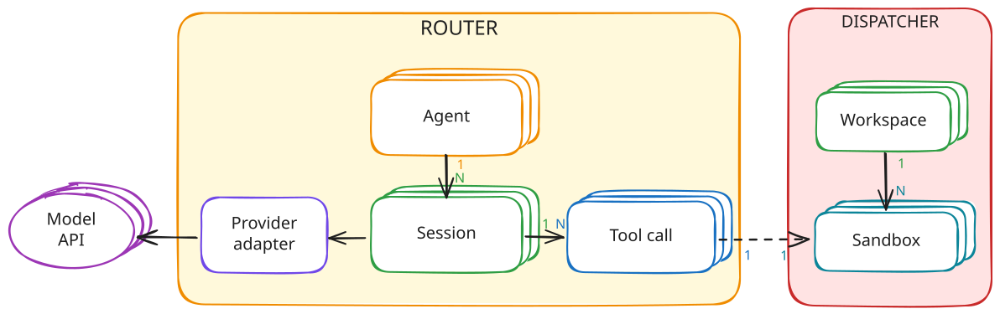
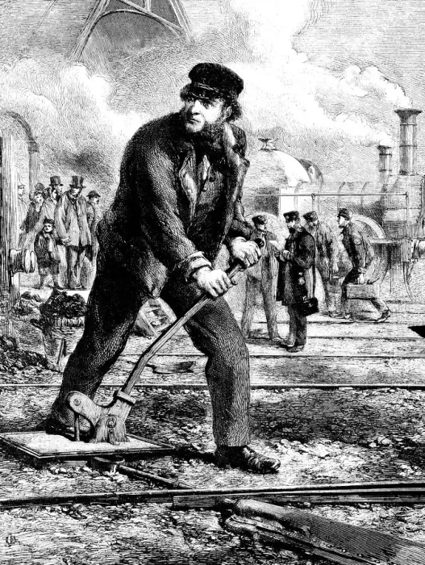

# pointsman



Pointsman is a router that runs the loop of many AI agents in parallel.\
It calls the model, records each session and delegates tool execution to external sandboxes.\
Since tool execution is decoupled from the harness, the router only passes data between the sandboxes and the model. A single router can therefore handle many simultaneous sessions.

## History
<table>
<tr>
<td valign="top">

A pointsman is the railway worker who operates the movable rails that send a train from one track to another. He stands at the junction and routes each train to the right track.

</td>
<td valign="top"></td>
</tr>
</table>

## Spec
See [SPEC.md](SPEC.md) for what this project is and how it is designed.

## Run

### Setup

Copy `.env.example` to `.env` update the values.

`.env` is read unless `ENVIRONMENT=production`.

```bash
go run ./cmd/dispatcher
go run ./cmd/router
```

### Playground

Try the API with [playground.http](playground.http). It lists the models, creates an agent and a session, and streams the events.

### Build

```bash
go build ./cmd/dispatcher
go build ./cmd/router
```

### Test

```bash
go test ./...
```
