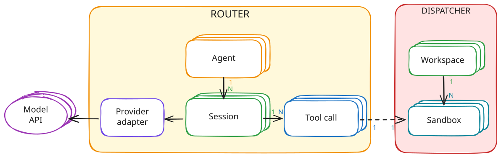
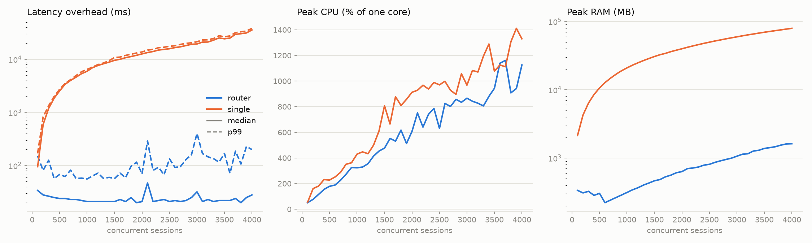

# pointsman



Pointsman is a router that runs the loop of many AI agents in parallel.\
It calls the model, records each session and delegates tool execution to external sandboxes.\
Since tool execution is decoupled from the harness, the router only passes data between the sandboxes and the model. A single router can therefore handle many simultaneous sessions.

## History
<table>
<tr>
<td valign="top">

A pointsman is the railway worker who operates the movable rails that send a train from one track to another. He stands at the junction and routes each train to the right track.

</td>
<td valign="top"></td>
</tr>
</table>

## Spec
See [SPEC.md](SPEC.md) for what this project is and how it is designed.

## Run the load experiment

It measures how the overhead grows with the number of sessions, through the router and as one process per session.
Run everything in WSL, each service in its own terminal, from the repo root.

### The experiment

N sessions start together, spread over 1 s by a seeded jitter. Each one runs 5 rounds of a model call and a tool call.

- **Sleep tool**: stands in for a slow real tool. It waits 500 to 3000 ms.
- **Fake model** (`cmd/fakemodel`): stands in for an LLM. It answers after a random 200 to 800 ms (the inference time) and calls the `sleep` tool for a random amount of time.

The sessions are seeded so it is reproducible and identical in every run:

**latency overhead** = the session's total time minus its inference and sleep times.
Peak CPU and RAM are summed over the three services.

Two setups run the same load:
- the router runs all sessions as goroutines in one process
- single mode starts one process per session

### Setup

Copy `.env.example` to `.env` and update the values.

Build every command. `sweep.py` finds the services by process name, so they must be built binaries, not `go run`:

```bash
go build ./cmd/dispatcher
go build ./cmd/fakemodel
go build ./cmd/router
go build ./cmd/singlesession
go build ./cmd/loadgenerator
```

### Router mode

```bash
./dispatcher
./fakemodel
./router
uv run scripts/sweep.py --start 100 --stop 4000 --step 100 --out sweep
```

### Single mode

```bash
./dispatcher
./fakemodel
uv run scripts/sweep.py --start 100 --stop 4000 --step 100 --single --out sweep-single
```

### Compare

```bash
uv run scripts/plot.py --router results/router/sweep.csv --single results/single/sweep.csv --out results/comparison.png
```

